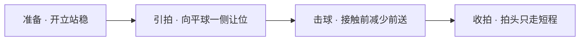

# 减力挡网

身体侧面平快球。本项观察目标为与平抽保持相近来球速度，比较触球前减速与回球落深。

## 动作流程

1. **准备**　开立站稳，拍头守在身前。
2. **引拍**　向平球一侧让位，持拍手提前到位。
3. **击球**　接触前减少前送，轻挡改变来球方向。
4. **收拍**　拍头只走短程，保持准备下一拍。

## 比赛录像中的动作

**片段 12 · 细分候选**　近端红衣低位宽站，拍在体侧只做小动作，随后双脚收近。 进入防守准备只需横移，轻挡应缩短收拍。 [播放近端比赛片段，1.56–2.36 秒](</Users/hua/Documents/project/BadmintonRally/data/羽毛球比赛视频/接球动作片段精选/04 中场侧身接平快球/12 减力挡网.mp4>)

四个时间点取自片段标注区间。肩、肘、腕、髋、膝和踝在同一片段内使用相同的缩放比例，低置信度点留空。转播画面无法给出握力、精确腕角或每次真实触球的帧号。

## 游戏中的动作与球路

右手、60 帧/秒的固定来球测试中，玩家目标是**减力挡网**，引擎根据输入与击球点给出的回法是**减力挡网**。触球前后相邻两帧，手肘移动 3.8 厘米。同一合成输入在基线的握点跳变量为 21.7 厘米，本轮为 6.6 厘米。位移按人物局部坐标计算。

自由飞行最高 2.02 米，终点距网 1.44 米，横向坐标 +1.15 米（以中线为零，近端视角向右为正）。这是按钮测试的固定输入。实际玩家的击球点和挥向会改变结果。[逐帧飞行坐标](</Users/hua/Documents/project/BadmintonRally/data/羽球比赛训练/九场景逐轮验证/20261124-123753-MR4t/自由飞行逐帧坐标.csv>)。

**恢复阶段追加检查。** 本项在触球后 117–800 毫秒窗口内，最大相邻帧握点位移为 3.7 厘米，出现在约 433 毫秒处。可用慢放检视减速、回位与下一拍准备之间的过渡。

## 下一轮验收

与平抽保持相近来球速度，比较触球前减速与回球落深。录像中优先观察“近端红衣低位宽站，拍在体侧只做小动作，随后双脚收近。”这一段的身体运动。用相同来球交替执行本组回法，保存按键时球相对身体的位置、实际出拍侧和出球轨迹，再回看准备与收拍能否衔接。左右手和不同帧率的数值取自本次逐项回放。[本轮完整指标](</Users/hua/Documents/project/BadmintonRally/data/羽球比赛训练/九场景逐轮验证/20261124-123753-MR4t/回放.csv>) · [本项游戏慢放](</Users/hua/Documents/project/BadmintonRally/data/羽球比赛训练/九场景逐轮验证/20261124-123753-MR4t/连续画面/减力挡网.mp4>)。

## 分镜与实跑差距

分镜第 3 格前臂伸出接平球，击后很快将拍收在前侧；游戏里持拍手几乎被身体挡住，最醒目的是球速变慢。侧视复核有无短迎和制动，轻挡时按来球远近调整步幅。

[查看减力挡网的优化记录、游戏实速与独立验收](单项优化.md)

## V2 女球员动作分镜

[查看四张独立姿势参考](../../../../assets/美术/女球员V2动作设定/姿势参考/减力挡网)。图片用于核对角色外形、动作轮廓和拍头位置；触球时刻依音量键记录。
