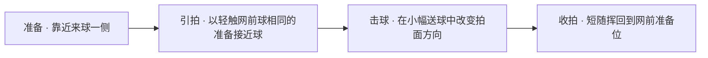

# 勾对角

贴网慢球。本项观察目标为保留轻力度，观察横向位移增加时纵深是否仍短。

## 动作流程

1. **准备**　靠近来球一侧，身前留出横向空间。
2. **引拍**　以轻触网前球相同的准备接近球。
3. **击球**　在小幅送球中改变拍面方向，按键确认横向出球。
4. **收拍**　短随挥回到网前准备位。

## 比赛录像中的动作

**片段 05 · 原标注对应**　近端白衣在右侧身体前伸手，黄衣对手晚一步横移。 允许挥幅很小仍有横向出球角；手腕旋转度数需近镜。 [播放近端比赛片段，1.56–2.36 秒](</Users/hua/Documents/project/BadmintonRally/data/羽毛球比赛视频/接球动作片段精选/02 网前接近网带/05 勾对角.mp4>)

四个时间点取自片段标注区间。肩、肘、腕、髋、膝和踝在同一片段内使用相同的缩放比例，低置信度点留空。转播画面无法给出握力、精确腕角或每次真实触球的帧号。

## 游戏中的动作与球路

右手、60 帧/秒的固定来球测试中，玩家目标是**勾对角**，引擎根据输入与击球点给出的回法是**勾对角**。触球前后相邻两帧，手肘移动 6.9 厘米。同一合成输入在基线的握点跳变量为 10.4 厘米，本轮为 3.6 厘米。位移按人物局部坐标计算。

自由飞行最高 1.83 米，终点距网 1.08 米，横向坐标 -1.14 米（以中线为零，近端视角向右为正）。这是按钮测试的固定输入。实际玩家的击球点和挥向会改变结果。[逐帧飞行坐标](</Users/hua/Documents/project/BadmintonRally/data/羽球比赛训练/九场景逐轮验证/20261124-123753-MR4t/自由飞行逐帧坐标.csv>)。

**恢复阶段追加检查。** 本项在触球后 117–800 毫秒窗口内，最大相邻帧握点位移为 2.5 厘米，出现在约 483 毫秒处。可用慢放检视减速、回位与下一拍准备之间的过渡。

## 下一轮验收

保留轻力度，观察横向位移增加时纵深是否仍短。录像中优先观察“近端白衣在右侧身体前伸手，黄衣对手晚一步横移。”这一段的身体运动。用相同来球交替执行本组回法，保存按键时球相对身体的位置、实际出拍侧和出球轨迹，再回看准备与收拍能否衔接。左右手和不同帧率的数值取自本次逐项回放。[本轮完整指标](</Users/hua/Documents/project/BadmintonRally/data/羽球比赛训练/九场景逐轮验证/20261124-123753-MR4t/回放.csv>) · [本项游戏慢放](</Users/hua/Documents/project/BadmintonRally/data/羽球比赛训练/九场景逐轮验证/20261124-123753-MR4t/连续画面/勾对角.mp4>)。

## 分镜与实跑差距

分镜第 3 格显示在身前横向带拍，单一斜侧机位很难说明离拍横角，游戏里则能直接看到球横向离开。保持与放直线相近的挥幅，比较两路在同等落深下的横向过网位置。

[查看勾对角的优化记录、游戏实速与独立验收](单项优化.md)

## V2 女球员动作分镜

[查看四张独立姿势参考](../../../../assets/美术/女球员V2动作设定/姿势参考/勾对角)。图片用于核对角色外形、动作轮廓和拍头位置；触球时刻依音量键记录。
