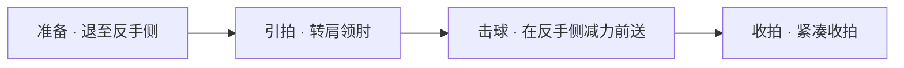

# 反手吊球

反手底角深球。本项观察目标为同一反手位分别打深打浅，球路差异不能依赖任务名。

## 动作流程

1. **准备**　退至反手侧，使用与反手高远相近的准备。
2. **引拍**　转肩领肘，拍面在高位迎球。
3. **击球**　在反手侧减力前送，把球落在对方前区。
4. **收拍**　紧凑收拍，转身向中线恢复。

## 比赛录像中的动作

**片段 29 · 细分候选**　近端红衣在左侧深跨着地后回身，远端前移接应。 原标注仅为吊球；左侧线路不等同于反手，不能训练绝对握法。 [播放近端比赛片段，1.56–2.44 秒](</Users/hua/Documents/project/BadmintonRally/data/羽毛球比赛视频/接球动作片段精选/09 后场反手底角/29 反手吊球.mp4>)

四个时间点取自片段标注区间。肩、肘、腕、髋、膝和踝在同一片段内使用相同的缩放比例，低置信度点留空。转播画面无法给出握力、精确腕角或每次真实触球的帧号。

## 游戏中的动作与球路

右手、60 帧/秒的固定来球测试中，玩家目标是**反手吊球**，引擎根据输入与击球点给出的回法是**反手吊球**。触球前后相邻两帧，手肘移动 3.6 厘米。同一合成输入在基线的握点跳变量为 10.4 厘米，本轮为 3.9 厘米。位移按人物局部坐标计算。

自由飞行最高 2.72 米，终点距网 1.68 米，横向坐标 -2.52 米（以中线为零，近端视角向右为正）。这是按钮测试的固定输入。实际玩家的击球点和挥向会改变结果。[逐帧飞行坐标](</Users/hua/Documents/project/BadmintonRally/data/羽球比赛训练/九场景逐轮验证/20261124-123753-MR4t/自由飞行逐帧坐标.csv>)。

**恢复阶段追加检查。** 本项在触球后 117–800 毫秒窗口内，最大相邻帧握点位移为 7.0 厘米，出现在约 417 毫秒处。可用慢放检视减速、回位与下一拍准备之间的过渡。

## 下一轮验收

同一反手位分别打深打浅，球路差异不能依赖任务名。录像中优先观察“近端红衣在左侧深跨着地后回身，远端前移接应。”这一段的身体运动。用相同来球交替执行本组回法，保存按键时球相对身体的位置、实际出拍侧和出球轨迹，再回看准备与收拍能否衔接。左右手和不同帧率的数值取自本次逐项回放。[本轮完整指标](</Users/hua/Documents/project/BadmintonRally/data/羽球比赛训练/九场景逐轮验证/20261124-123753-MR4t/回放.csv>) · [本项游戏慢放](</Users/hua/Documents/project/BadmintonRally/data/羽球比赛训练/九场景逐轮验证/20261124-123753-MR4t/连续画面/反手吊球.mp4>)。

## 分镜与实跑差距

分镜第 2、3 格从转体架拍到侧前方轻送，游戏与反手高远共享准备，后面的短球弧线比手上的减速更容易看清。在相同反手底角复测触球后前臂行程和刹拍时间，再看前场落点；保留原比赛片段对握法的不确定性。

[查看反手吊球的优化记录、游戏实速与独立验收](单项优化.md)

## V2 女球员动作分镜

[查看四张独立姿势参考](../../../../assets/美术/女球员V2动作设定/姿势参考/反手吊球)。图片用于核对角色外形、动作轮廓和拍头位置；触球时刻依音量键记录。
