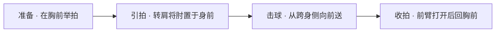

# 反手平抽

身体侧面平快球。本项观察目标为同一落点比较正反手在按键后数帧的肩转和拍面。

## 动作流程

1. **准备**　在胸前举拍，准备覆盖非持拍侧。
2. **引拍**　转肩将肘置于身前，拍头横向让开。
3. **击球**　从跨身侧向前送，缩短大摆臂。
4. **收拍**　前臂打开后回胸前，脚下恢复宽站。

## 比赛录像中的动作

**片段 11 · 细分候选**　近端白衣偏左，单步横伸后回到开立姿态，身体转幅有限。 与10使用相同目标落点，仍应能看出从另一侧出拍；握法需近镜。 [播放近端比赛片段，1.56–1.88 秒](</Users/hua/Documents/project/BadmintonRally/data/羽毛球比赛视频/接球动作片段精选/04 中场侧身接平快球/11 反手平抽.mp4>)

四个时间点取自片段标注区间。肩、肘、腕、髋、膝和踝在同一片段内使用相同的缩放比例，低置信度点留空。转播画面无法给出握力、精确腕角或每次真实触球的帧号。

## 游戏中的动作与球路

右手、60 帧/秒的固定来球测试中，玩家目标是**反手平抽**，引擎根据输入与击球点给出的回法是**反手平抽**。触球前后相邻两帧，手肘移动 5.8 厘米。同一合成输入在基线的握点跳变量为 27.1 厘米，本轮为 8.1 厘米。位移按人物局部坐标计算。

自由飞行最高 1.78 米，终点距网 5.52 米，横向坐标 +1.69 米（以中线为零，近端视角向右为正）。这是按钮测试的固定输入。实际玩家的击球点和挥向会改变结果。[逐帧飞行坐标](</Users/hua/Documents/project/BadmintonRally/data/羽球比赛训练/九场景逐轮验证/20261124-123753-MR4t/自由飞行逐帧坐标.csv>)。

**恢复阶段追加检查。** 本项在触球后 117–800 毫秒窗口内，最大相邻帧握点位移为 13.0 厘米，出现在约 567 毫秒处。可用慢放检视减速、回位与下一拍准备之间的过渡。

## 下一轮验收

同一落点比较正反手在按键后数帧的肩转和拍面。录像中优先观察“近端白衣偏左，单步横伸后回到开立姿态，身体转幅有限。”这一段的身体运动。用相同来球交替执行本组回法，保存按键时球相对身体的位置、实际出拍侧和出球轨迹，再回看准备与收拍能否衔接。左右手和不同帧率的数值取自本次逐项回放。[本轮完整指标](</Users/hua/Documents/project/BadmintonRally/data/羽球比赛训练/九场景逐轮验证/20261124-123753-MR4t/回放.csv>) · [本项游戏慢放](</Users/hua/Documents/project/BadmintonRally/data/羽球比赛训练/九场景逐轮验证/20261124-123753-MR4t/连续画面/反手平抽.mp4>)。

## 分镜与实跑差距

分镜的前臂从身前跨出，伸臂时由同侧腿支撑；游戏在按键前与正手共享来球准备，按键后的横向展臂才明显。固定同一落点测试正反手，看肘在腕的哪侧和肩转方向，同时保留两者打同一路线的可能。

[查看反手平抽的优化记录、游戏实速与独立验收](单项优化.md)

## V2 女球员动作分镜

[查看四张独立姿势参考](../../../../assets/美术/女球员V2动作设定/姿势参考/反手平抽)。图片用于核对角色外形、动作轮廓和拍头位置；触球时刻依音量键记录。
