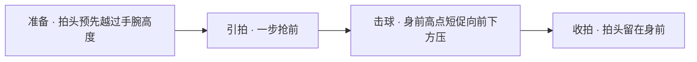

# 扑球

网前高点机会球。本项观察目标为同高度交替扑球和轻放网，比较离拍前段的下降量。

## 动作流程

1. **准备**　拍头预先越过手腕高度，目光守住网口。
2. **引拍**　一步抢前，肘在身前，拍头只退一小段。
3. **击球**　身前高点短促向前下方压，按键确认。
4. **收拍**　拍头留在身前，前腿承重后蹬回。

## 比赛录像中的动作

**片段 01 · 原标注对应**　近端黑衣先举拍，左前区向前一步，随后上身回正。 相同高点先举拍，动作应短促；与长后摆杀球分开。 [播放近端比赛片段，1.53–1.67 秒](</Users/hua/Documents/project/BadmintonRally/data/羽毛球比赛视频/接球动作片段精选/01 网前高于网带/01 扑球.mp4>)

四个时间点取自片段标注区间。肩、肘、腕、髋、膝和踝在同一片段内使用相同的缩放比例，低置信度点留空。转播画面无法给出握力、精确腕角或每次真实触球的帧号。

## 游戏中的动作与球路

右手、60 帧/秒的固定来球测试中，玩家目标是**扑球**，引擎根据输入与击球点给出的回法是**扑球**。触球前后相邻两帧，手肘移动 2.3 厘米。同一合成输入在基线的握点跳变量为 8.9 厘米，本轮为 2.3 厘米。位移按人物局部坐标计算。

自由飞行最高 1.90 米，终点距网 3.13 米，横向坐标 +1.13 米（以中线为零，近端视角向右为正）。这是按钮测试的固定输入。实际玩家的击球点和挥向会改变结果。[逐帧飞行坐标](</Users/hua/Documents/project/BadmintonRally/data/羽球比赛训练/九场景逐轮验证/20261124-123753-MR4t/自由飞行逐帧坐标.csv>)。

**恢复阶段追加检查。** 本项在触球后 117–800 毫秒窗口内，最大相邻帧握点位移为 3.3 厘米，出现在约 117 毫秒处。可用慢放检视减速、回位与下一拍准备之间的过渡。

## 下一轮验收

同高度交替扑球和轻放网，比较离拍前段的下降量。录像中优先观察“近端黑衣先举拍，左前区向前一步，随后上身回正。”这一段的身体运动。用相同来球交替执行本组回法，保存按键时球相对身体的位置、实际出拍侧和出球轨迹，再回看准备与收拍能否衔接。左右手和不同帧率的数值取自本次逐项回放。[本轮完整指标](</Users/hua/Documents/project/BadmintonRally/data/羽球比赛训练/九场景逐轮验证/20261124-123753-MR4t/回放.csv>) · [本项游戏慢放](</Users/hua/Documents/project/BadmintonRally/data/羽球比赛训练/九场景逐轮验证/20261124-123753-MR4t/连续画面/扑球.mp4>)。

## 分镜与实跑差距

分镜第 3 格的持拍手伸到身体前方，下一格拍头停在手下；游戏背面看手臂与肩重叠，但拍头在击后 150 毫秒确有下压。保留短下压，近端侧视复核前脚落稳和刹拍的先后，再决定是否需要加深弓步。

[查看扑球的优化记录、游戏实速与独立验收](单项优化.md)

## V2 女球员动作分镜

[查看四张独立姿势参考](../../../../assets/美术/女球员V2动作设定/姿势参考/扑球)。图片用于核对角色外形、动作轮廓和拍头位置；触球时刻依音量键记录。
