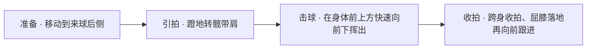

# 扣杀

后场到位高球。本项观察目标为与高远球比较出射斜率、落地姿态和再次启动时间。

## 动作流程

1. **准备**　移动到来球后侧，留出前方攻击空间。
2. **引拍**　蹬地转髋带肩，持拍肘在高处蓄势。
3. **击球**　在身体前上方快速向前下挥出。
4. **收拍**　跨身收拍、屈膝落地再向前跟进。

## 比赛录像中的动作

**片段 24 · 前后拍标注对应**　近端黑衣从高处出手，空中换腿，落地时双脚分开较宽。 近端身躯应先转动后制动，贴网高度和落点另测。 [播放近端比赛片段，1.53–2.00 秒](</Users/hua/Documents/project/BadmintonRally/data/羽毛球比赛视频/接球动作片段精选/07 后场到位高球/24 扣杀.mp4>)

**片段 32 · 画面判读候选**　近端橙衣在右后侧完成起跳高点击球，落地后继续向前跟进。 用来核对起跳—落地—跟进的连续性；原片无球种标注。 [播放近端比赛片段，1.56–2.56 秒](</Users/hua/Documents/project/BadmintonRally/data/羽毛球比赛视频/接球动作片段精选/07 后场到位高球/32 扣杀.mp4>)

四个时间点取自片段标注区间。肩、肘、腕、髋、膝和踝在同一片段内使用相同的缩放比例，低置信度点留空。转播画面无法给出握力、精确腕角或每次真实触球的帧号。

## 游戏中的动作与球路

右手、60 帧/秒的固定来球测试中，玩家目标是**扣杀**，引擎根据输入与击球点给出的回法是**扣杀**。触球前后相邻两帧，手肘移动 2.9 厘米。同一合成输入在基线的握点跳变量为 9.4 厘米，本轮为 2.9 厘米。位移按人物局部坐标计算。

自由飞行最高 2.82 米，终点距网 5.41 米，横向坐标 +2.11 米（以中线为零，近端视角向右为正）。这是按钮测试的固定输入。实际玩家的击球点和挥向会改变结果。[逐帧飞行坐标](</Users/hua/Documents/project/BadmintonRally/data/羽球比赛训练/九场景逐轮验证/20261124-123753-MR4t/自由飞行逐帧坐标.csv>)。

**恢复阶段追加检查。** 本项在触球后 117–800 毫秒窗口内，最大相邻帧握点位移为 6.6 厘米，出现在约 283 毫秒处。可用慢放检视减速、回位与下一拍准备之间的过渡。

## 下一轮验收

与高远球比较出射斜率、落地姿态和再次启动时间。录像中优先观察“近端黑衣从高处出手，空中换腿，落地时双脚分开较宽。”这一段的身体运动。用相同来球交替执行本组回法，保存按键时球相对身体的位置、实际出拍侧和出球轨迹，再回看准备与收拍能否衔接。左右手和不同帧率的数值取自本次逐项回放。[本轮完整指标](</Users/hua/Documents/project/BadmintonRally/data/羽球比赛训练/九场景逐轮验证/20261124-123753-MR4t/回放.csv>) · [本项游戏慢放](</Users/hua/Documents/project/BadmintonRally/data/羽球比赛训练/九场景逐轮验证/20261124-123753-MR4t/连续画面/扣杀.mp4>)。

## 分镜与实跑差距

分镜把腾空、持拍肘伸展和屈膝落地分得很清楚，游戏由背后看高举拍有余，双腿换重心与落地时序不够醒目。对比真人第 24 段和游戏侧视回放，分别核对离地、击球、落地三刻，避免一律在滞空最高处按固定帧触球。

[查看扣杀的优化记录、游戏实速与独立验收](单项优化.md)

## V2 女球员动作分镜

[查看四张独立姿势参考](../../../../assets/美术/女球员V2动作设定/姿势参考/扣杀)。图片用于核对角色外形、动作轮廓和拍头位置；触球时刻依音量键记录。
