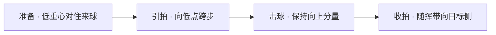

# 挑对角

网前低点下落球。本项观察目标为在近似弧顶条件下核对落点横向位移及翼侧。

## 动作流程

1. **准备**　低重心对住来球，先准备前上挥。
2. **引拍**　向低点跨步，调整前臂朝向另一侧。
3. **击球**　保持向上分量，同时向斜对侧送球。
4. **收拍**　随挥带向目标侧，恢复正面站姿。

## 比赛录像中的动作

**片段 08 · 细分候选**　近端黄衣从右侧接球后收步回中，对手更靠后半场。 持拍侧相似时比较横向过网位置；对角终点仍需跟踪。 [播放近端比赛片段，1.56–2.92 秒](</Users/hua/Documents/project/BadmintonRally/data/羽毛球比赛视频/接球动作片段精选/03 网前低于网带/08 挑对角.mp4>)

四个时间点取自片段标注区间。肩、肘、腕、髋、膝和踝在同一片段内使用相同的缩放比例，低置信度点留空。转播画面无法给出握力、精确腕角或每次真实触球的帧号。

## 游戏中的动作与球路

右手、60 帧/秒的固定来球测试中，玩家目标是**挑对角**，引擎根据输入与击球点给出的回法是**挑对角**。触球前后相邻两帧，手肘移动 2.9 厘米。同一合成输入在基线的握点跳变量为 17.3 厘米，本轮为 7.4 厘米。位移按人物局部坐标计算。

自由飞行最高 6.10 米，终点距网 5.60 米，横向坐标 -1.61 米（以中线为零，近端视角向右为正）。这是按钮测试的固定输入。实际玩家的击球点和挥向会改变结果。[逐帧飞行坐标](</Users/hua/Documents/project/BadmintonRally/data/羽球比赛训练/九场景逐轮验证/20261124-123753-MR4t/自由飞行逐帧坐标.csv>)。

**恢复阶段追加检查。** 本项在触球后 117–800 毫秒窗口内，最大相邻帧握点位移为 9.4 厘米，出现在约 117 毫秒处。可用慢放检视减速、回位与下一拍准备之间的过渡。

## 下一轮验收

在近似弧顶条件下核对落点横向位移及翼侧。录像中优先观察“近端黄衣从右侧接球后收步回中，对手更靠后半场。”这一段的身体运动。用相同来球交替执行本组回法，保存按键时球相对身体的位置、实际出拍侧和出球轨迹，再回看准备与收拍能否衔接。左右手和不同帧率的数值取自本次逐项回放。[本轮完整指标](</Users/hua/Documents/project/BadmintonRally/data/羽球比赛训练/九场景逐轮验证/20261124-123753-MR4t/回放.csv>) · [本项游戏慢放](</Users/hua/Documents/project/BadmintonRally/data/羽球比赛训练/九场景逐轮验证/20261124-123753-MR4t/连续画面/挑对角.mp4>)。

## 分镜与实跑差距

分镜里低位托起和上步很清楚，但最后一格画的高弧只说明向上，横向角度受到视角压缩。保留与直线挑球接近的弧高和深度，用俯视过网点解释游戏里的线路区别。

[查看挑对角的优化记录、游戏实速与独立验收](单项优化.md)

## V2 女球员动作分镜

[查看四张独立姿势参考](../../../../assets/美术/女球员V2动作设定/姿势参考/挑对角)。图片用于核对角色外形、动作轮廓和拍头位置；触球时刻依音量键记录。
