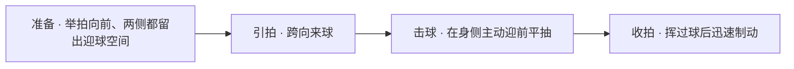

# 接杀反抽

接杀防守。本项观察目标为对比相同跨距的挡网，检查前向初速和飞行时间。

## 动作流程

1. **准备**　举拍向前、两侧都留出迎球空间。
2. **引拍**　跨向来球，前臂短引准备再加速。
3. **击球**　在身侧主动迎前平抽，按键确认穿过球的瞬间。
4. **收拍**　挥过球后迅速制动，脚下回中。

## 比赛录像中的动作

**片段 17 · 前后拍标注对应**　近端黑衣从准备位斜跨，持拍臂侧向伸出又迅速收回。 反抽对比短挡须有更多前送速度；两者都可屈膝。 [播放近端比赛片段，1.56–2.36 秒](</Users/hua/Documents/project/BadmintonRally/data/羽毛球比赛视频/接球动作片段精选/05 中场接杀/17 接杀反抽.mp4>)

**片段 18 · 前后拍标注对应**　近端红衣在左前低位跨步，起身后重新开立。 与14对照，两种回法都有大横步；先验收出球平直度和速度。 [播放近端比赛片段，1.56–2.04 秒](</Users/hua/Documents/project/BadmintonRally/data/羽毛球比赛视频/接球动作片段精选/05 中场接杀/18 接杀反抽.mp4>)

四个时间点取自片段标注区间。肩、肘、腕、髋、膝和踝在同一片段内使用相同的缩放比例，低置信度点留空。转播画面无法给出握力、精确腕角或每次真实触球的帧号。

## 游戏中的动作与球路

右手、60 帧/秒的固定来球测试中，玩家目标是**接杀反抽**，引擎根据输入与击球点给出的回法是**接杀反抽**。触球前后相邻两帧，手肘移动 2.4 厘米。同一合成输入在基线的握点跳变量为 20.9 厘米，本轮为 6.6 厘米。位移按人物局部坐标计算。

自由飞行最高 1.73 米，终点距网 6.01 米，横向坐标 -0.84 米（以中线为零，近端视角向右为正）。这是按钮测试的固定输入。实际玩家的击球点和挥向会改变结果。[逐帧飞行坐标](</Users/hua/Documents/project/BadmintonRally/data/羽球比赛训练/九场景逐轮验证/20261124-123753-MR4t/自由飞行逐帧坐标.csv>)。

**恢复阶段追加检查。** 本项在触球后 117–800 毫秒窗口内，最大相邻帧握点位移为 8.3 厘米，出现在约 550 毫秒处。可用慢放检视减速、回位与下一拍准备之间的过渡。

## 下一轮验收

对比相同跨距的挡网，检查前向初速和飞行时间。录像中优先观察“近端黑衣从准备位斜跨，持拍臂侧向伸出又迅速收回。”这一段的身体运动。用相同来球交替执行本组回法，保存按键时球相对身体的位置、实际出拍侧和出球轨迹，再回看准备与收拍能否衔接。左右手和不同帧率的数值取自本次逐项回放。[本轮完整指标](</Users/hua/Documents/project/BadmintonRally/data/羽球比赛训练/九场景逐轮验证/20261124-123753-MR4t/回放.csv>) · [本项游戏慢放](</Users/hua/Documents/project/BadmintonRally/data/羽球比赛训练/九场景逐轮验证/20261124-123753-MR4t/连续画面/接杀反抽.mp4>)。

## 分镜与实跑差距

分镜从体侧准备过渡到跨步迎前，持拍臂的伸出比短挡更明显；游戏接杀三招开头一致，击后球路才清楚分开。与挡网固定同一个触球点，检查确认后约 100 毫秒的前送速度能否让玩家从人物动作看出反抽。

[查看接杀反抽的优化记录、游戏实速与独立验收](单项优化.md)

## V2 女球员动作分镜

[查看四张独立姿势参考](../../../../assets/美术/女球员V2动作设定/姿势参考/接杀反抽)。图片用于核对角色外形、动作轮廓和拍头位置；触球时刻依音量键记录。
