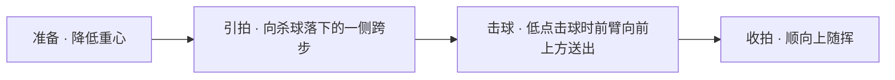

# 接杀挑高

接杀防守。本项观察目标为与同一来球的挡网比较弧顶、过网高度和落深。

## 动作流程

1. **准备**　降低重心，预留拍头向上的行程。
2. **引拍**　向杀球落下的一侧跨步，在球下方准备。
3. **击球**　低点击球时前臂向前上方送出。
4. **收拍**　顺向上随挥，支撑腿带身体重新站起。

## 比赛录像中的动作

**片段 15 · 前后拍标注对应**　近端黄衣屈膝向右伸臂，下一拍远端球员仍能在后侧准备。 接杀可从低点上挑；输出弧顶应比同场景挡网高。 [播放近端比赛片段，1.56–2.28 秒](</Users/hua/Documents/project/BadmintonRally/data/羽毛球比赛视频/接球动作片段精选/05 中场接杀/15 接杀挑高.mp4>)

**片段 16 · 前后拍标注对应**　近端黄蓝衣向左深跨、上体下沉，随后从低处收回身体。 与15做左右镜像，着地和回位时序连续。 [播放近端比赛片段，1.56–2.36 秒](</Users/hua/Documents/project/BadmintonRally/data/羽毛球比赛视频/接球动作片段精选/05 中场接杀/16 接杀挑高.mp4>)

四个时间点取自片段标注区间。肩、肘、腕、髋、膝和踝在同一片段内使用相同的缩放比例，低置信度点留空。转播画面无法给出握力、精确腕角或每次真实触球的帧号。

## 游戏中的动作与球路

右手、60 帧/秒的固定来球测试中，玩家目标是**接杀挑高**，引擎根据输入与击球点给出的回法是**接杀挑高**。触球前后相邻两帧，手肘移动 2.4 厘米。同一合成输入在基线的握点跳变量为 20.9 厘米，本轮为 6.6 厘米。位移按人物局部坐标计算。

自由飞行最高 4.93 米，终点距网 5.80 米，横向坐标 +1.42 米（以中线为零，近端视角向右为正）。这是按钮测试的固定输入。实际玩家的击球点和挥向会改变结果。[逐帧飞行坐标](</Users/hua/Documents/project/BadmintonRally/data/羽球比赛训练/九场景逐轮验证/20261124-123753-MR4t/自由飞行逐帧坐标.csv>)。

**恢复阶段追加检查。** 本项在触球后 117–800 毫秒窗口内，最大相邻帧握点位移为 9.5 厘米，出现在约 117 毫秒处。可用慢放检视减速、回位与下一拍准备之间的过渡。

## 下一轮验收

与同一来球的挡网比较弧顶、过网高度和落深。录像中优先观察“近端黄衣屈膝向右伸臂，下一拍远端球员仍能在后侧准备。”这一段的身体运动。用相同来球交替执行本组回法，保存按键时球相对身体的位置、实际出拍侧和出球轨迹，再回看准备与收拍能否衔接。左右手和不同帧率的数值取自本次逐项回放。[本轮完整指标](</Users/hua/Documents/project/BadmintonRally/data/羽球比赛训练/九场景逐轮验证/20261124-123753-MR4t/回放.csv>) · [本项游戏慢放](</Users/hua/Documents/project/BadmintonRally/data/羽球比赛训练/九场景逐轮验证/20261124-123753-MR4t/连续画面/接杀挑高.mp4>)。

## 分镜与实跑差距

分镜里先低位迎球再抬前臂，持拍手和拍头都向上；游戏的挑高弧线清楚，但从背面难看出前臂究竟抬了多少。对照侧视拍头高度与肩、膝的时序，保留低点也能回到后场的高弧线。

[查看接杀挑高的优化记录、游戏实速与独立验收](单项优化.md)

## V2 女球员动作分镜

[查看四张独立姿势参考](../../../../assets/美术/女球员V2动作设定/姿势参考/接杀挑高)。图片用于核对角色外形、动作轮廓和拍头位置；触球时刻依音量键记录。
