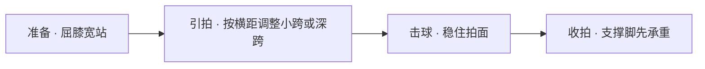

# 接杀挡网

接杀防守。本项观察目标为同一回法输入近身与远身来球，检查步幅与出球深浅。

## 动作流程

1. **准备**　屈膝宽站，先覆盖追身和两个侧面。
2. **引拍**　按横距调整小跨或深跨，肘在身前。
3. **击球**　稳住拍面，利用来球速度短挡过网。
4. **收拍**　支撑脚先承重，持拍臂短收，随后回蹬。

## 比赛录像中的动作

**片段 13 · 前后拍标注对应**　近端黄蓝衣左右脚分开后小幅侧探，迅速恢复在中场的开立姿态。 标准横距下短挡，避免为所有挡网都强制深跨。 [播放近端比赛片段，1.56–2.36 秒](</Users/hua/Documents/project/BadmintonRally/data/羽毛球比赛视频/接球动作片段精选/05 中场接杀/13 接杀挡网.mp4>)

**片段 14 · 前后拍标注对应**　近端红衣从宽站向左前低跨，随后继续前移，起身较迟。 远身球需要更深的支撑腿弯曲与侧移；与13构成同回法不同步幅测试。 [播放近端比赛片段，1.56–2.36 秒](</Users/hua/Documents/project/BadmintonRally/data/羽毛球比赛视频/接球动作片段精选/05 中场接杀/14 接杀挡网.mp4>)

四个时间点取自片段标注区间。肩、肘、腕、髋、膝和踝在同一片段内使用相同的缩放比例，低置信度点留空。转播画面无法给出握力、精确腕角或每次真实触球的帧号。

## 游戏中的动作与球路

右手、60 帧/秒的固定来球测试中，玩家目标是**接杀挡网**，引擎根据输入与击球点给出的回法是**接杀挡网**。触球前后相邻两帧，手肘移动 0.8 厘米。同一合成输入在基线的握点跳变量为 20.7 厘米，本轮为 6.1 厘米。位移按人物局部坐标计算。

自由飞行最高 2.02 米，终点距网 1.15 米，横向坐标 +1.18 米（以中线为零，近端视角向右为正）。这是按钮测试的固定输入。实际玩家的击球点和挥向会改变结果。[逐帧飞行坐标](</Users/hua/Documents/project/BadmintonRally/data/羽球比赛训练/九场景逐轮验证/20261124-123753-MR4t/自由飞行逐帧坐标.csv>)。

**恢复阶段追加检查。** 本项在触球后 117–800 毫秒窗口内，最大相邻帧握点位移为 6.8 厘米，出现在约 567 毫秒处。可用慢放检视减速、回位与下一拍准备之间的过渡。

## 下一轮验收

同一回法输入近身与远身来球，检查步幅与出球深浅。录像中优先观察“近端黄蓝衣左右脚分开后小幅侧探，迅速恢复在中场的开立姿态。”这一段的身体运动。用相同来球交替执行本组回法，保存按键时球相对身体的位置、实际出拍侧和出球轨迹，再回看准备与收拍能否衔接。左右手和不同帧率的数值取自本次逐项回放。[本轮完整指标](</Users/hua/Documents/project/BadmintonRally/data/羽球比赛训练/九场景逐轮验证/20261124-123753-MR4t/回放.csv>) · [本项游戏慢放](</Users/hua/Documents/project/BadmintonRally/data/羽球比赛训练/九场景逐轮验证/20261124-123753-MR4t/连续画面/接杀挡网.mp4>)。

## 分镜与实跑差距

分镜画了很深的侧弓步，游戏这一颗离身体较近，触球时的步幅较小，而比赛第 13、14 段两种幅度都能出现。按球相对身体的横距分别复测前脚落稳、骨盆侧移和持拍手短挡，无需每拍都跨到极限。

[查看接杀挡网的优化记录、游戏实速与独立验收](单项优化.md)

## V2 女球员动作分镜

[查看四张独立姿势参考](../../../../assets/美术/女球员V2动作设定/姿势参考/接杀挡网)。图片用于核对角色外形、动作轮廓和拍头位置；触球时刻依音量键记录。
