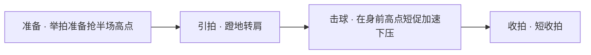

# 点杀

半场高球。本项观察目标为相同高度减小挥幅仍应有下压效果，保持与轻吊可分。

## 动作流程

1. **准备**　举拍准备抢半场高点。
2. **引拍**　蹬地转肩，肘抬起，缩短后摆。
3. **击球**　在身前高点短促加速下压。
4. **收拍**　短收拍，若腾空则先落稳再接下一拍。

## 比赛录像中的动作

**片段 19 · 细分候选**　近端黄衣起跳，躯干侧屈，随挥时一腿抬起平衡，再着地。 点杀允许腾空，短促发力也可下压。这个角度不能标腕关节速度。 [播放近端比赛片段，1.56–1.96 秒](</Users/hua/Documents/project/BadmintonRally/data/羽毛球比赛视频/接球动作片段精选/06 中场半场高点/19 点杀.mp4>)

四个时间点取自片段标注区间。肩、肘、腕、髋、膝和踝在同一片段内使用相同的缩放比例，低置信度点留空。转播画面无法给出握力、精确腕角或每次真实触球的帧号。

## 游戏中的动作与球路

右手、60 帧/秒的固定来球测试中，玩家目标是**点杀**，引擎根据输入与击球点给出的回法是**点杀**。触球前后相邻两帧，手肘移动 4.7 厘米。同一合成输入在基线的握点跳变量为 11.4 厘米，本轮为 4.9 厘米。位移按人物局部坐标计算。

自由飞行最高 2.21 米，终点距网 2.90 米，横向坐标 +1.23 米（以中线为零，近端视角向右为正）。这是按钮测试的固定输入。实际玩家的击球点和挥向会改变结果。[逐帧飞行坐标](</Users/hua/Documents/project/BadmintonRally/data/羽球比赛训练/九场景逐轮验证/20261124-123753-MR4t/自由飞行逐帧坐标.csv>)。

**恢复阶段追加检查。** 本项在触球后 117–800 毫秒窗口内，最大相邻帧握点位移为 5.8 厘米，出现在约 117 毫秒处。可用慢放检视减速、回位与下一拍准备之间的过渡。

## 下一轮验收

相同高度减小挥幅仍应有下压效果，保持与轻吊可分。录像中优先观察“近端黄衣起跳，躯干侧屈，随挥时一腿抬起平衡，再着地。”这一段的身体运动。用相同来球交替执行本组回法，保存按键时球相对身体的位置、实际出拍侧和出球轨迹，再回看准备与收拍能否衔接。左右手和不同帧率的数值取自本次逐项回放。[本轮完整指标](</Users/hua/Documents/project/BadmintonRally/data/羽球比赛训练/九场景逐轮验证/20261124-123753-MR4t/回放.csv>) · [本项游戏慢放](</Users/hua/Documents/project/BadmintonRally/data/羽球比赛训练/九场景逐轮验证/20261124-123753-MR4t/连续画面/点杀.mp4>)。

## 分镜与实跑差距

分镜采用小跳到高点再短促下压，游戏这颗球能够站着够到，人物双脚在触球图里没有画出同样的腾空。按可触达高度分别测站立点杀与小跳点杀，收拍都应短于大幅扣杀。

[查看点杀的优化记录、游戏实速与独立验收](单项优化.md)

## V2 女球员动作分镜

[查看四张独立姿势参考](../../../../assets/美术/女球员V2动作设定/姿势参考/点杀)。图片用于核对角色外形、动作轮廓和拍头位置；触球时刻依音量键记录。
