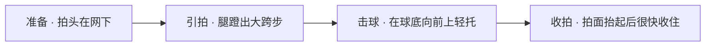

# 轻托回网

网前低点下落球。本项观察目标为大步轻托和同位置重挑应得到明显不同的纵深。

## 动作流程

1. **准备**　拍头在网下，准备低位救球。
2. **引拍**　腿蹬出大跨步，手上仍留余量。
3. **击球**　在球底向前上轻托，只给过网所需的高度。
4. **收拍**　拍面抬起后很快收住，再从弓步起身。

## 比赛录像中的动作

**片段 09 · 细分候选**　近端黄衣从中区急赶左前场，低位大跨，收脚较晚。 角色追得急也能打轻球，避免将大步幅当成大挥力。 [播放近端比赛片段，1.56–2.52 秒](</Users/hua/Documents/project/BadmintonRally/data/羽毛球比赛视频/接球动作片段精选/03 网前低于网带/09 轻托回网.mp4>)

四个时间点取自片段标注区间。肩、肘、腕、髋、膝和踝在同一片段内使用相同的缩放比例，低置信度点留空。转播画面无法给出握力、精确腕角或每次真实触球的帧号。

## 游戏中的动作与球路

右手、60 帧/秒的固定来球测试中，玩家目标是**轻托回网**，引擎根据输入与击球点给出的回法是**轻托回网**。触球前后相邻两帧，手肘移动 2.9 厘米。同一合成输入在基线的握点跳变量为 17.3 厘米，本轮为 7.4 厘米。位移按人物局部坐标计算。

自由飞行最高 1.97 米，终点距网 1.08 米，横向坐标 +1.41 米（以中线为零，近端视角向右为正）。这是按钮测试的固定输入。实际玩家的击球点和挥向会改变结果。[逐帧飞行坐标](</Users/hua/Documents/project/BadmintonRally/data/羽球比赛训练/九场景逐轮验证/20261124-123753-MR4t/自由飞行逐帧坐标.csv>)。

**恢复阶段追加检查。** 本项在触球后 117–800 毫秒窗口内，最大相邻帧握点位移为 8.4 厘米，出现在约 550 毫秒处。可用慢放检视减速、回位与下一拍准备之间的过渡。

## 下一轮验收

大步轻托和同位置重挑应得到明显不同的纵深。录像中优先观察“近端黄衣从中区急赶左前场，低位大跨，收脚较晚。”这一段的身体运动。用相同来球交替执行本组回法，保存按键时球相对身体的位置、实际出拍侧和出球轨迹，再回看准备与收拍能否衔接。左右手和不同帧率的数值取自本次逐项回放。[本轮完整指标](</Users/hua/Documents/project/BadmintonRally/data/羽球比赛训练/九场景逐轮验证/20261124-123753-MR4t/回放.csv>) · [本项游戏慢放](</Users/hua/Documents/project/BadmintonRally/data/羽球比赛训练/九场景逐轮验证/20261124-123753-MR4t/连续画面/轻托回网.mp4>)。

## 分镜与实跑差距

分镜的触球格拍面接近水平，随挥仅回到身前；游戏与挑球共享低点跨步，第四格的短球才拉开差别。侧视检查轻托离拍后的持拍手制动，避免以挑球的大幅向上随挥结束。

[查看轻托回网的优化记录、游戏实速与独立验收](单项优化.md)

## V2 女球员动作分镜

[查看四张独立姿势参考](../../../../assets/美术/女球员V2动作设定/姿势参考/轻托回网)。图片用于核对角色外形、动作轮廓和拍头位置；触球时刻依音量键记录。
