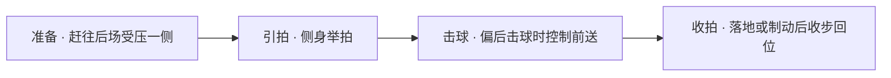

# 过渡吊球

平快压底线。本项观察目标为与同一高度的主动吊球对比到位余量和回位时长。

## 动作流程

1. **准备**　赶往后场受压一侧，准备保回合。
2. **引拍**　侧身举拍，减小来不及完成的大引拍。
3. **击球**　偏后击球时控制前送，把球送浅。
4. **收拍**　落地或制动后收步回位。

## 比赛录像中的动作

**片段 27 · 细分候选**　近端黄衣在右后侧侧身举拍，向外跨一步才再次面网。 受压吊球允许更晚收步，回球贴近网后前场的实际距离需测。 [播放近端比赛片段，1.56–2.28 秒](</Users/hua/Documents/project/BadmintonRally/data/羽毛球比赛视频/接球动作片段精选/08 后场受压/27 过渡吊球.mp4>)

四个时间点取自片段标注区间。肩、肘、腕、髋、膝和踝在同一片段内使用相同的缩放比例，低置信度点留空。转播画面无法给出握力、精确腕角或每次真实触球的帧号。

## 游戏中的动作与球路

右手、60 帧/秒的固定来球测试中，玩家目标是**过渡吊球**，引擎根据输入与击球点给出的回法是**过渡吊球**。触球前后相邻两帧，手肘移动 2.6 厘米。同一合成输入在基线的握点跳变量为 8.1 厘米，本轮为 2.8 厘米。位移按人物局部坐标计算。

自由飞行最高 2.30 米，终点距网 1.70 米，横向坐标 +1.69 米（以中线为零，近端视角向右为正）。这是按钮测试的固定输入。实际玩家的击球点和挥向会改变结果。[逐帧飞行坐标](</Users/hua/Documents/project/BadmintonRally/data/羽球比赛训练/九场景逐轮验证/20261124-123753-MR4t/自由飞行逐帧坐标.csv>)。

**恢复阶段追加检查。** 本项在触球后 117–800 毫秒窗口内，最大相邻帧握点位移为 6.0 厘米，出现在约 200 毫秒处。可用慢放检视减速、回位与下一拍准备之间的过渡。

## 下一轮验收

与同一高度的主动吊球对比到位余量和回位时长。录像中优先观察“近端黄衣在右后侧侧身举拍，向外跨一步才再次面网。”这一段的身体运动。用相同来球交替执行本组回法，保存按键时球相对身体的位置、实际出拍侧和出球轨迹，再回看准备与收拍能否衔接。左右手和不同帧率的数值取自本次逐项回放。[本轮完整指标](</Users/hua/Documents/project/BadmintonRally/data/羽球比赛训练/九场景逐轮验证/20261124-123753-MR4t/回放.csv>) · [本项游戏慢放](</Users/hua/Documents/project/BadmintonRally/data/羽球比赛训练/九场景逐轮验证/20261124-123753-MR4t/连续画面/过渡吊球.mp4>)。

## 分镜与实跑差距

分镜表现宽站稳住后上手轻送，游戏在受压来球中从更低处处理，触球前拍头和持拍臂多被身体挡住。保留来不及完整架拍也能吊回前场的变化，侧视检查最后一次制动和出拍后回中心的时间是否接得上。

## 第 11 轮：同一来球，改变按键时机

固定挥动力度、方向与来球，分别在预计击球点之前、附近和之后确认触球。以下为右手 60 Hz 合成输入，正的身体前距表示球在角色与球网之间。第一组图和六轮实测保留作基线。

|计划偏移 ms|击球高度 m|身体前距 m|旧版→当前握点单帧位移 cm|实际落深 m|结果|
|---:|---:|---:|---:|---:|---|
|-65|1.73|+1.17|91.0 → 8.9|1.70|过网|
|+0|1.41|+0.60|2.8 → 8.3|1.70|过网|
|+65|1.15|+0.19|37.9 → 6.6|1.70|过网|
|+150|0.60|-0.49|49.5 → 3.2|1.70|过网|
|+200|0.31|-0.78|91.2 → 10.0|1.70|过网|

[同一角色早、中、晚按键的画面对照](</Users/hua/Documents/project/BadmintonRally/data/羽球比赛训练/后场时机复核/11连续屈膝/过渡吊球时机对照.jpg>) · [独立验证与逐帧记录](</Users/hua/Documents/project/BadmintonRally/data/羽球比赛训练/后场时机复核/11连续屈膝/独立测试报告.md>)

准点接球时，新版会继续沿来球方向移动拍头，表内单帧位移因此可能增加。与实拍对比时，应同时测握点、拍头与球在同一帧的位移。

[查看过渡吊球的优化记录、游戏实速与独立验收](单项优化.md)

## V2 女球员动作分镜

[查看四张独立姿势参考](../../../../assets/美术/女球员V2动作设定/姿势参考/过渡吊球)。图片用于核对角色外形、动作轮廓和拍头位置；触球时刻依音量键记录。
