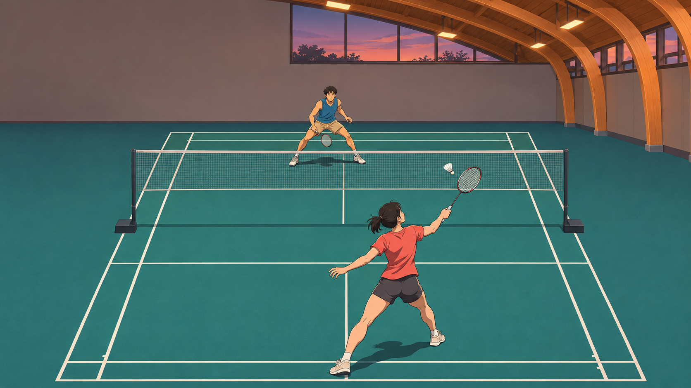

# BadmintonRally · 羽毛球体感游戏需求文档

首版设计稿 v0.4 ｜ iPhone 单人对战电脑 ｜ 客厅电视镜像 ｜ 2026-11-21

## 1. 玩家体验与交付边界

玩家面向电视，惯用手握住 iPhone，手肘自然弯曲。电视里自己的球员站在近端，对手站在远端。看见高球时向下轻挥，手机在击中时短振，球员随之扣球。对手把球挡回网前，玩家改用上挑救球。球员自动跑位，玩家可以全程站在原地。一场比赛要让初次体验者明白三件事——球在哪里、什么时候挥、上一球为什么失分。

首版交付一个原创球馆、两位可互换角色、左右手模式、自由练习、单人快速赛、三档电脑对手、投屏辅助及本地成绩。快速赛目标 2–4 分钟，首次教学目标 90 秒内完成。后续候选为第二场馆、同机轮流挑战和双手机联机。首版比赛状态只在一台 iPhone 上运行，电视作为显示设备。

参考视频中的时间对应下列设计依据。参数、角色、场景和局制均为本项目设计初值，需通过试玩定稿。

|片段|采用的运动决策|项目中的表现|
|---|---|---|
|00:09–00:32|挥拍方向控制落点，高球下扣、低球上挑|左右三个落点区，扣杀和高远球两条主路线|
|00:33–01:06|低位强扣或距离过远产生被动回球|短滞空、晃动的机会球，明确显示“击球点太低”或“够球太远”|
|01:08–01:24|自动走位，及时准备有利于下一拍|回正后提早开始回中，动作提示随教学逐步消退|
|01:26–01:48|网前球改变攻防节奏，连续扣杀加速|手机拇指短按锁定下一拍放网，机会扣杀有速度上限|

## 2. 操作、投屏与界面流程

1. 首次启动选择惯用手、普通或轻挥模式。用示意图指导握紧手机、确认手臂周围有挥动空间。教学用腕部小动作即可完成。设置里随时更改惯用手。
2. 投屏页展示「同一 Wi-Fi → 打开控制中心 → 屏幕镜像 → 选择电视 → 返回游戏」。支持 Apple TV 或兼容 AirPlay 的电视，也提供本机练习入口。只在设置和局间要求看手机。镜像呈现同一画面，横屏布局固定，挥动时保持画面方向。手机实际握姿通过校准独立确定。
3. 体感开赛先自然握稳一秒，依次采集上挑、下挥、平抽各两次，再按提示独立试打各一次。未通过的步骤保留在当前动作，显示原因。换手可重录，续局可复用本局模板。
4. 教学依次练习上挑、下扣、左右落点、放网；每项连续成功两次通过，可跳过。正式局开球前倒数 3、2、1。准备发球时做一次轻上挑。首次发球失败可重试，超过 5 秒显示动作提示，练习模式可开自动发球。
5. 比赛画面左上比分和发球标记，右上暂停，球影显示地面位置。底部在教学或连续两次相同失误后给一句纠错。手机屏幕下半部在比赛中设为大的放网触区，避开系统手势边缘，左右手均可触达。短按松手后轻振一次，预选下一拍放网，1.5 秒、回合结束、再次短按均可取消。暂停区与放网区互斥。
6. 暂停提供继续、重新居中、重做同步、退出；继续前重新倒数。进后台、传感器断流或检测到镜像中断时冻结比分和球。回到前台由玩家选择恢复，刚才中断的一球重发。投屏状态检测能力随系统路径验证，同时提供手动暂停。结束页展示比分、最长回合、成功救球次数、最常见失误、再来一局。

官方接入依据见 [Apple 屏幕镜像说明](https://support.apple.com/en-us/102661)。

## 3. 一球的规则与手感

快速赛每球得分，先到 7 分获胜，6 平后领先 2 分获胜，9 平后下一分决胜。得分方发下一球。首球由玩家发。自由练习无限供球，选择高球、低球、左右交替或随机，可查看最近十拍反馈。

|来球及操作|回球|可读反馈|
|---|---|---|
|高于角色肩部，及时下挥|快而陡的进攻球|金色短直尾迹、清脆击球声|
|低球或来不及进攻，向上挑|高弧线到底线附近，争取回位时间|蓝色点状尾迹、较轻的拍声|
|预选放网，在可击范围内轻挥|刚过网即下坠，逼对手上前|薄荷色短弧、网前落点提示|
|低位下挥，或仅在伸手极限够到|被动挑高，给对方扣杀机会|紫色波纹、角色踉跄|
|对手回出机会球，在高点下扣|强力扣杀，连续成功最多加速两级|双线尾迹、较重触感|
|挥空、球碰地或合法回球未过网|本球结束一次，获胜方加一分|落点圈停留约 0.6 秒，再报比分|

每次击球先判能否触球，再判放网意图，再按高度、挥向和时机判球型。方向不明确且来球可够到时，初学档回中路普通球。正常回球的目标落点向边线内收，保持回合连贯。压线算界内，球擦网后越网继续。出界或回球落在本方均判击球方失分。机会球只给对手优势，最终由实际接球结果决定得分。

### 球、球员与电脑对手

场内逻辑使用米。单打场地设计采用宽 5.18、长 13.40，网在纵向中点。近端和远端共用一套逻辑坐标，给远端重新映射左右。用水平位置、离地高度和飞行时间驱动画面。原型可采用两段平滑曲线经过击球点、过网点和目标落点；每帧检测网平面处高度及首次触地。击球后锁定轨迹，球影始终在地面投影，镜头缩放不影响判定。

|初始调参项|试做值|调整依据|
|---|---|---|
|高远球 / 扣杀 / 放网飞行时间|1.1–1.5 / 0.55–0.8 / 0.75–1.0 秒|电视上能看清起手和过网；新手档统一降速|
|击球高度|腰下优先救球，肩上允许扣杀，中间区域容许两类动作|用角色身高比例表达，换角色沿用|
|触球范围|躯干到预计接触点水平距离 ≤0.85 米为正常，≤1.15 米为勉强救球|先按距离，再看时间窗；教学额外放宽|
|有效时间窗|预计接触前后各 130 毫秒，练习各 200 毫秒|投屏偏移独立补偿，防止重复放宽|
|恢复与回中|普通回球后约 300 毫秒；踉跄约 550 毫秒；回正奖励最多提前 100 毫秒|无需大幅度收拍，超时自动恢复|
|连续强扣|每级缩短飞行时间约 8%，两级封顶|普通回球、失分或新回合清零|

自动走位根据对方击球后的预测轨迹选可达拦截点，受起步延迟、移动速度和恢复状态约束。角色移动速度原型设为 3.5 米/秒。站得远或被放网调动时，即使玩家挥向正确也可能只能勉强救球。电脑沿用相同的触球和移动规则，只读取已出手的球。入门、标准、挑战三档起步延迟暂定 320/230/150 毫秒，分别偏好回中、调动两侧、前后场组合。种子化随机控制落点和时机误差，便于重现争议球。

## 4. 手机如何识别一次挥拍

iPhone 使用 Core Motion 的设备运动数据。四元数表示朝向，gravity 给出竖直参照，rotationRate 给出角速度，userAcceleration 提供去除重力后的加速度。算法输出挥拍事件；虚拟球员和虚拟球的位置由游戏计算。真实手腕的三维位置无法从这套输入稳定获得。参考项目的姿态映射可借鉴，挥拍还需要分段、去重和击球时机判定。[Apple 设备运动数据](https://developer.apple.com/documentation/coremotion/getting-processed-device-motion-data)

### 当前版本的赛前校准和判拍

玩家用比赛时的手自然握紧手机。页面显示动作名、方向、拍数、验收结果。校准和比赛均使用机身三轴，允许自然倾角。每组两拍建立一个个人样本组，随后另做三拍验证。即使同一个动作能稳定复现，仍需确认它能与另外两类区分。玩家按指令为样本提供标签，系统检查重复性；它无法评定羽毛球技术动作是否规范。

|环节|实际判定|玩家看到或得到的结果|
|---|---|---|
|握稳|请求 100 Hz 设备运动，使用样本时间戳。角速度低于 0.35 rad/s 且去重力加速度低于 0.12 g，持续一秒。记录平均重力和角速度噪声峰|建立本局准备姿势。移动会重新累计稳定时间|
|六拍采样|上挑、下挥、平抽各做两次。以角速度主峰方向与短窗积分方向描述一拍，加速度或足够的转角辅助确认|两拍不一致时保留最新一拍并提示重做；太像之前的动作时保持当前步骤|
|独立试打|按同样顺序各试一拍。用两份模板的平均方向相似度排名，第一名须达到 0.70 且领先第二名至少 0.08|显示错认的动作或提示方向不清，三类通过后才可进入球场|
|实战|复用试打分类器，主峰时间用于判球，最迟约 320 ms 结束候选窗。相对样本的水平转动用于估算落点偏移。游戏结合来球高度、角色位置和击球窗口确定球路|回正并安静约 120 ms 后才允许再触发。面板显示最近识别和回正提示|
|恢复或换手|暂停后保留本局模板，重新核对握姿倾角。采样中断时暂停，主动重新校准会清除本局模板|可重新握稳、重录全组或改用触屏。新比赛重新建模|

轻挥模式降低起手噪声底限与最小转角。阈值属于原型参数，尚需测量真实手持时的漏拍、错分和回摆误触。传感器只观察手机运动。重力能给出倾斜参照，无法单独测出水平朝向、手指位置或握力。上挑触发的高球、下挥触发的扣杀均为游戏映射。个性化样本特征仅存在本次运行内存中；需要保存原始时间序列时，另走首页「动作采集」流程。

交互参考包括 Switch 的静止校准，以及《健身环大冒险》按指令完成动作、确认后更新个人设置的流程。本游戏选择舒适短挥，六拍建模与三拍试打均为本项目设计。[Nintendo 手柄校准](https://en-americas-support.nintendo.com/app/answers/detail/a_id/22340/) · [Nintendo 健身环校准](https://en-americas-support.nintendo.com/app/answers/detail/a_id/47750/) · [Apple CMDeviceMotion](https://developer.apple.com/documentation/coremotion/cmdevicemotion)

### 投屏延迟与判定公平性

首次镜像后做 8 次同步练习。电视上的球按节拍经过目标圈，玩家看到重合时轻点手机。取后 6 次“触摸时间减本地目标经过时间”的中位数作为**显示延迟加个人反应的综合偏移**，允许试打、手动微调或跳过。此测量包含反应差异，需再用真实挥拍验证。初始补偿上限 250 毫秒。保留最近约 600 毫秒球和球员状态，以“主峰时间减偏移”回查接触范围和时间窗。落地后暂缓最终结算至补偿与识别等待窗结束，每球事件只结算一次。延迟波动过大时提示改用较慢球速、重测或本机练习。

## 5. 人物、场景与美术方向

**主风格为原创二维运动插画，使用分层球场和可绑定骨骼的角色。** 视觉主题是傍晚的社区木构球馆。暖木梁、蓝绿色地胶、浅色球网形成三层明度。人物约五头身，手、拍、鞋略放大。轮廓干净，衣服用两档明暗；光源固定左上。比赛用背后略俯视的固定机位，让玩家同时看清近端球员肩部、球网和远端落点。四种回球用轨迹形状、击球声和颜色共同区分。

### 人物设定与生图描述

|角色|外形和识别点|可直接用于生图的主体描述|
|---|---|---|
|林澄，默认近端|年轻成年女性，紧凑身形，深棕短马尾，珊瑚红上衣、炭灰短裤、米白运动鞋。袖口单条米白斜纹|社区羽毛球运动员，屈膝待球，重心略靠前，背面四分之三视角，露出持拍手和肘部，短马尾形成清晰侧轮廓；腰胯和两脚分开，服装无文字|
|周野，默认远端|年轻成年男性，高瘦，短卷发，湖蓝无袖背心、沙色短裤、深色运动鞋。上衣两侧深蓝拼片|高瘦的社区羽毛球运动员，正面四分之三朝向镜头，肩膀放松，持拍手抬至腰侧，膝盖微屈，视线追随前方来球；卷发边缘简洁，双鞋清楚分开|

两人都出正面、侧面、背面和比赛用前后四分之三视图。身形与服装只影响外观。换人和左手模式复用同一触球范围。为镜像姿势检查持拍手、鞋尖方向和光照；左右不对称服饰须单独修正。角色定稿先出中立姿势与色卡，所有动作引用同一角色母图。

### 场景构图与分层

主球馆名「晚风球社」。背景生成描述可用“傍晚社区羽毛球馆内景，暖色层压木拱梁，远墙高窗透出雾蓝天空，右后方两排空长椅，柔和漫射光，平涂运动插画，单点透视，镜头位于近端底线后方上空，中央比赛区明度均匀，边缘细节集中”。按下表分别生成空背景和独立物件。球场线、网的位置和 HUD 由程序按同一投影绘制，避免画出的球线与实际落点错位。

统一设计画布 1920×1080。坐标原点左上。网线中心约在 (960,480)，近端底线中心约在 (960,925)，远端底线中心约在 (960,320)。近端底线宽约 1340 px，远端约 610 px，先用灰盒验证透视再锁美术。近端球员常态高 240–300 px，远端 125–165 px，飞行中的球最小视觉直径目标 18 px。比分和教学文字距边缘至少 5%。不同屏幕比例等比适配，允许留边，始终保住整块有效球场。

|场景或页面|生产要求|用途|
|---|---|---|
|首页|同一球馆入口，木制门框在右，倚墙球拍和长椅在下方，左半留干净墙面；1920×1080|左侧排开始比赛、练习和设置|
|校准与教学|简化青灰背景，手握手机的近景图居中，配程序箭头；手势图 768×768 透明|即使关声音也能看懂握法、上挑与下扣|
|训练场|复用比赛场，降低远墙饱和度，地面叠加目标圈；练习供球点固定|练习球型、方向与时机|
|比赛场|远墙与屋顶、远端长椅、素地板、网柱分层；墙面保留较暗连续区|让高空白球和低空球影都清晰|
|结算|复用球馆背景加遮罩，角色胜利或鼓掌姿势放右侧，左侧排比分与统计|重用角色与场景，便于制作再赛流程|

### 生图交付清单与尺寸

尺寸均为像素。透明素材使用 sRGB RGBA PNG，满幅背景使用 sRGB PNG 母版。重要物体四周留约 10% 空边。相同资产固定画幅、视角、比例、主色和光源。输出按角色、球馆、器材、特效分类。文件示例为 char_lin_back_ready_v01.png。

|资产|数量与母版规格|拆分和验收|
|---|---|---|
|角色设定板|每人 1 张，3072×2048|中立旋转视图、发型、鞋、色卡；生产角色时固定此参考|
|比赛角色|2 人 × 前后两视角，单体母版各 1536×1536|头发、头、胸胯、上臂、前臂、持拍手、大腿、小腿、鞋独立透明层；关节下补画遮挡部分，脚底锚点固定|
|动作关键姿势|每人每比赛视角 10 姿，各 1024×1024 参考图|待机、侧步、上挑、下扣、放网、伸手救球、踉跄、回正、庆祝、鼓掌。按角色母图修形后供骨骼动画参考|
|球馆和首页|首页 1 张，球馆远景、地面、长椅各 1 层，3840×2160|远景不含球员、球、网、场线或文字。所有层沿同一画布原点对齐，内部场景按 1920×1080 合成预览|
|球拍及羽毛球|球拍 2 款，各 512×1024；白色羽毛球侧、斜、顶视各 256×256|拍柄握点登记为锚点。球托用暖灰阴影，羽裙轮廓在暗地板与亮墙均清楚|
|教学图与头像|自然握持、上挑、下扣、放网触控各 1 张 768×768；左右手各验一套。头像 2 张 512×512|手指数、手机朝向和腕部弯曲逐张检查；箭头与文字由程序叠加|
|反馈与界面|4 种轨迹笔刷、球影、落点圈、击球闪光各 1 张 256×256；暂停、声音、振动等用系统图标|离屏导出透明，边缘无白边；比分、按钮文案全部用活文字|
|应用图标|1024×1024 方形母版 1 张|深青底，中央一枚斜向上飞的白色羽毛球，尾部一笔珊瑚红轨迹，小尺寸检查剪影|

**通用提示词尾段**可直接接在上述主体描述后面：“原创运动游戏美术，简洁二维平涂，清晰外轮廓，左上柔光，两档阴影，深青 #205657、珊瑚红 #E56A50、米白 #F4EBDD，形体完整，画面无字、无水印、无品牌标识”。人物另加“单角色、完整手脚、纯色可抠背景、镜头与角色参考图一致”。生成后人工抠图、补关节和绑定。先做一个角色、一把拍和一张球场合成样张，在电视上从 2–3 米外判断球和手是否清楚，再批量出图。

### 动画、音效和触感

待机 1.2 秒循环，侧步 0.4 秒循环。每种挥拍拆为预备、触球、随挥、恢复四段。挥拍反馈直接响应检测事件，触球关键帧对准拍面锚点；用动画混合处理移动中击球。分层顺序按球场深度变化，远端选手可被网遮挡，球在网前后正确切换；落地阴影独立缩放。强扣用 80–120 毫秒局部闪光和短拖尾，减少动态效果模式关闭闪光、屏震。

音效至少制作轻击、挑球、扣杀、触网、落地、鞋底摩擦、得分、结束及低音量场馆环境声。母版 48 kHz WAV；击球音至少两种变化，程序控制音量和同类音效并发。手机短振确认有效击球，重扣稍强，挥空只给视觉提示。声音、振动可单独关闭。电视声音可能有传输延迟，击球判定统一使用本机时间。

## 6. 工程、数据与质量

建议首版采用 Swift、Core Motion、SpriteKit 和 SwiftUI。SpriteKit 负责球场、动画、球和特效，SwiftUI 负责菜单与设置。采用固定 60 Hz 游戏逻辑步长并按屏幕刷新插值。传感器独立采样。把挥拍识别与比赛逻辑拆开，可用记录文件回放同一拍，也可在模拟器用按键注入挥拍事件调试比分、AI 和轨迹。

|组件|职责及主要输入输出|
|---|---|
|运动采集与校准|样本时间戳、姿态、加速度、角速度 → 校准坐标与挥拍事件|
|回合裁判|挥拍事件、历史球状态、球员可达范围 → 命中结果、失误原因和唯一得分事件|
|球与球员模拟|击球结果 → 球轨迹、接触时间、自动走位、回中；时间推进可暂停和回放|
|画面与反馈|只消费模拟状态和事件，统一控制动画、文字、音效和触感|
|本地存储|保存惯用手、辅助设置、声音、教程进度、练习纪录和比赛摘要。局内临时状态在新局明确清空|
|开发诊断|调试模式可导出带真值标注的短窗运动样本和回合事件；正式版默认仅在内存处理原始样本。清除记录入口放设置页|

状态流为首页 → 配置 → 校准 → 教学或开赛 → 发球 → 飞行与击球 → 死球 → 得分 → 再发球或结算。每次状态转移明确当前发球权、球权、回合 ID 和可接受的输入。重复回调、后台恢复、暂停时挥拍、倒计时期间触摸均不得额外得分。MVP 可离线完成比赛，无需注册。传感器不可用时说明原因并提供操作说明或触屏演示。

## 7. 验收、制作顺序与待实测项

以下是内部目标，需用真机实测后记录设备、系统、电视、镜像方式和结果。

|验收项|测试方法与过线目标|
|---|---|
|动作识别|至少 8 名不同握姿的体验者，覆盖左右手；每人每类上挑、下扣各 20 次，方向左右中各 10 次。按人划分调参组与留出组。目标两类挥拍召回率各 ≥90%，方向正确率 ≥85%，单挥重复触发 <2%|
|误触与轻挥|取放手机、握姿微调、点屏、回摆各测；静止或非比赛操作误判目标 ≤1 次/分钟。轻挥模式能完成上挑、下扣和放网教学|
|真实投屏|至少两款 iPhone、Apple TV 和兼容电视各一台，测本机、镜像、断开重连、电视游戏模式。用高速录像分别记录本机动作到反馈及电视相对本机的延迟，报告中位数和 P95；补偿后各做 20 次定点接球并比较成功率|
|规则与边界|验证 6 平、8 平、9 平决胜，压线、擦网、挥空、回摆重复事件、机会球被成功救回、中断重发、结算后再来一局；所有路径每球最多记 1 分|
|可读与可玩|在 2–3 米外辨认比分、球、球影、四类尾迹；静音能完成教学。首次体验者中至少 6/8 可独立开始比赛，并完成一段五拍回合|
|性能|最低目标设备连续镜像比赛 20 分钟，目标 60 fps，本机 P95 帧耗时 ≤20 毫秒；记录发热、内存峰值、采样间隙和音效重复播放。后台停止采样与游戏推进|

**制作顺序**

1. **动作原型**。只显示波形、动作名、力度和时间，收集舒适握姿样本。交付带真值的回放样本和首张识别混淆表。
2. **可玩灰盒**。用色块人物、球和地线完成发球、走位、三种主动回球、机会球、AI 与计分。用电视确认能完成五拍回合，先定镜头和触球窗口。
3. **美术样张与首馆**。锁定透视、比例、角色母图、动作锚点，再批量生图和绑定。出一张近端扣杀、远端防守的实机合成图，验证遮挡。
4. **完整首版**。补齐菜单、教学、音效、触感、无障碍设置、断线恢复和本地记录，完成整场连续试玩。
5. **发布候选**。实机覆盖性能及镜像路径，确认素材使用权、应用图标、隐私说明、商店截图、测试记录和版本号。以达到实测门槛作为发布条件。

优先验证的三个产品假设是：单手握持时预选网前球是否容易、电视延迟补偿能否保持扣杀节奏、角色自动走位失误是否容易理解。每项均记录失败片段和玩家原话。若盲按吃力，优先试更大的触区或增加轻挥放网辅助；若延迟抖动明显，优先降练习球速；若玩家把失分归因于传感器，先补明确的时机和距离反馈。最低支持机型及系统版本在真机测试后锁定。

## 8. iOS 实施细则

### 8.1 真机先打通的一条链路

Xcode 新建 iOS App，SwiftUI 承载首页、校准页和暂停层，比赛页用 SpriteView 承载一个长期存活的 SKScene。MatchSession 持有唯一一份球、比分、AI 和输入缓冲。SwiftUI 视图刷新时复用该实例。比赛页锁定横屏渲染，允许选择手机顶部的持握方向；设备坐标始终按机身定义。提供本地化的 NSMotionUsageDescription，说明运动数据用于识别挥拍。启动时检查 isDeviceMotionAvailable，并处理采样错误与重新校准。

一次可玩的开发切片只需五个事件：发出练习高球、采到挥拍主峰、判为向下、球在高点可达、播放扣杀并刷新比分。调试界面并列显示“识别：向下挥”“裁判：过早 180 ms”。即使挥空也能看到动作是否已被正确识别，开发者可以定位该调传感器还是调球速。

### 8.2 电视如何显示、怎样返回

|节点|iPhone 的实现|验收动作|
|---|---|---|
|进入球馆|主窗口承载完整游戏，无线镜像由用户在控制中心连接。进入控制中心时暂停计时，返回后提供“电视已显示／先在手机练习”|分别测试先镜像再开 App、已开 App 再镜像|
|适配画面|球场统一按 1920×1080 参考尺寸等比适配，触控热区按手机窗口的 point 计算；转换触点时剔除留边，暂停优先于放网|在超宽手机和 16:9 电视检查近端底线、比分和按钮。镜像链路可能留黑边|
|挥拍时|比赛期间保持屏幕唤醒，离开比赛恢复系统策略。手机和电视显示同一场比赛，拇指预选放网用触感确认|锁屏、来电、切后台再回到比赛，均先暂停并清除待处理挥拍|
|断开镜像|普通镜像缺少可靠断连信号的路径保留手动暂停；不要用录屏检测结果判断电视连接。再次连接后允许重测同步|实际拔线或断开 AirPlay，记录各路径能否自动感知|
|未来双屏模式|若希望手机只显示手柄、电视只显示比赛，单独提供外接显示场景。外屏窗口订阅 MatchSession 的同一快照，手机拥有输入和模拟时钟。iOS 27 起按系统版本注册 externalNonInteractive 场景附件，旧系统按外接场景生命周期接入；断开时释放外屏渲染器|同一局切换显示端，比分不重复、球速不加倍。首版仅需交付系统镜像|

[Apple 外接显示与系统版本差异](https://developer.apple.com/documentation/uikit/presenting-content-on-a-connected-display) · [Apple 镜像操作](https://support.apple.com/en-us/102661)

### 8.3 从一段传感器信号到一种球

**游戏中把高远球定义为高弧线落到后场的回球。** 首版教学用上挑触发，允许玩家轻量还原动作。真实羽毛球还可以用头顶正手动作打出高远球，这种动作和扣杀的引拍很像；握手机能测得转动与加速度，无法直接测真实拍面触球角和击球高度。如果产品要支持真实头顶高远球，先作为扩展输入单独采样和验收。正式局先让上挑、下扣两种动作稳定可辨。

取 .xArbitraryZVertical 参考系，从自然握姿确定手机指向电视的水平轴 F、向上轴 U 和电视右轴 R。用静态已知姿态验证旋转矩阵的方向：屏幕朝上时，设备重力变换后应约等于 −U；将手机顶端朝电视右转，算出的水平角必须增加。每个样本将机身长轴变到参考系得 d，以 atan2(d·R,d·F) 算水平角，以 atan2(d·U,hypot(d·F,d·R)) 算仰角。近竖直时沿用最近可靠的左右目标；恢复正常握姿后重新采信。角速度单位 rad/s，加速度用 g，所有时间用同一单调时钟。

|动作|让玩家怎么做|取哪段信号、认什么|游戏裁判怎么出球|
|---|---|---|---|
|下挥扣杀|来球高时，手机顶部从斜上方向前下方短促压下|引拍可能先上扬。以主速度峰附近约 80 ms 的带符号仰角变化判断下压，同时要求窗口内向下样本占多数；收拍段不参加分类|高位且时机正确为扣杀；低位强压变机会球；相距太远判挥空|
|上挑高远球|从腰前舒适位置向前上方挑起，允许小幅动作|同一窗口内仰角持续增加，速度形成单峰。躯干抬起但手机角度几乎不变时降置信度|可达时出高弧线，目标落在所选方向后场；极限距离回出较短的被动球|
|头顶高远球，实验项|头顶引拍后向前上方送出|候选特征包括主挥段终止仰角、挥后方向、峰前后竖直加速度与持续时间。用同一人同速度的扣杀作对照，单独评估两类混淆|训练数据充分后再开放；低置信度优先给可解释的普通回球|
|放网|拇指短按后做舒适的小挥|触控锁存意图，挥拍时间仍取传感器主峰。触摸引起的短尖峰与持续转动分别检查|优先检查能否够到，成功则落在对方网后近区|
|收拍、换手、抖动|回到自然握姿或停下|已发事件后进入恢复态，直到冷却完成且速度回落；长时缓慢转动、静止尖峰、仅绕长轴拧腕均作反例|回正只影响角色恢复，不能生成第二次击球|

**处理先后顺序**：保存原始时间戳 → 对角速度作短窗平滑 → 用环形缓冲回看起手 → 锁定候选主峰 → 确认下降沿 → 用峰前后轨迹分类 → 发出一次 SwingEvent → 在历史比赛快照上判击球。首次试做用峰值后 20–40 ms 的有限确认窗口，不等整个收拍结束。若强起手与正挥各有一峰，按主挥方向持续性和教学样本选择有效峰；先用录像复核误判，再决定是否引入序列分类模型。[Apple 运动采样](https://developer.apple.com/documentation/coremotion/cmmotionmanager)

**一拍的可回放例子**：本机预测 10.000 秒触球，镜像综合偏移 120 ms，手机读到下挥主峰 10.135 秒，下降沿在 10.165 秒确认。回查时刻为 10.015 秒，时机误差仅 +15 ms。此时虚拟球高过肩、角色距接触点 0.55 米，输出扣杀。完全相同的运动数据遇到腰以下来球，应输出低位强压的被动球。用这对输入做回归用例，可以发现重复扣延迟或把“识别下挥”直接写成“必定扣杀”的错误。

**采集表**每拍记录参与者匿名编号、惯用手、机型、握姿、模式、教练指定动作、实际观察动作、起止与主峰时间、预测类别、游戏结果和拒识原因。每位参与者补录慢上挑、轻扣、斜挥、强回摆、只平移、触屏、调整握姿。单独统计扣杀被认成高远球、漏识别、一次挥两拍；按参与者留出验证，左右手及轻挥组分别报告。显示实际采样间隔 P95、峰后确认耗时 P95 和电视显示延迟，分别调优。

## 9. 界面施工图与可复制生图任务

样张用于确认角色配色、前后场层次和黄昏木构球馆的氛围。实机镜头按第 5 节缩小近端角色并留足底线空间，场线由逻辑坐标生成。

### 9.1 电视看比赛，手机负责触摸

以下布局数字以 1920×1080 横屏逻辑画布、左上为原点。SpriteKit 若以左下为原点，导入时统一转换 y 值。界面文字使用系统中文字体，数字用等宽数字样式。手机交互按钮热区至少 44×44 pt。

|界面|布局与视觉层级|操作与状态|
|---|---|---|
|首页|左侧约 38% 放标题和主按钮“开始比赛”，次按钮“自由练习”；右侧是双人入场插画|设置上次惯用手作为默认值。重返首页时聚焦开始比赛|
|校准|横屏显示准备姿势、动作方向、当前拍数和进度|失败时给出回正、改方向或重试提示。试打通过后开放进入球场|
|比赛|比分卡 (96,60)，约 360×108；数字 56 px，昵称 32 px。暂停在右上安全区；教学短句位于底部中间，约 36 px。中间球路区域留空|发球权用小球图标。放网预选在比分下出现“下一拍放网”，随命中或取消消失。正式局只在死球后显示失误原因|
|暂停与结算|降低场景亮度，中央放继续或再赛。结算左侧比分和最多三项统计，右侧角色庆祝|继续前倒数；退出比赛二次确认。设置可关闭振动、减弱动态效果、开启高对比尾迹|

### 9.2 图模型出图工单

把第 5 节的色卡和通用提示尾段附在每条提示词后。前两张定稿作为人物与场馆参考图，后续采用带参考图的编辑流程。以下尺寸指交付母版；模型比例不符时留边排版，避免拉伸人物。每次只请求一个角色的一种视角或一张独立物件。

|工单与规格|可复制的主体提示词|制作人员的处理|
|---|---|---|
|林澄背面母图，1536×1536|全身，成年女羽毛球员，短棕马尾、珊瑚短袖、米白袖口斜纹、深灰短裤。背面偏三分之四面向球网，屈膝分腿，持拍侧肘与躯干之间有空隙。鞋底在同一基线上，纯透明背景，四周留空。|锁定头身比例和服装。另出正面比赛图供交换场地使用|
|周野正面母图，1536×1536|全身，成年男羽毛球员，瘦高、短卷发、湖蓝背心和沙色球裤，面向近端来球，双脚宽于肩，前脚轻点地，握拍手和胸部轮廓分离，透明背景。|缩放至 140 px 高检查头、前臂和球拍仍可分辨|
|扣杀姿势，1024×1024 每姿|沿用角色定稿、比例与机位。分别请求三张：肩外上方引拍、身体前上方伸臂触球、拍沿对侧髋部收势。保持同一握拍手，五指握住拍柄末端，球拍长轴清晰。|提取关节姿势作为动画参考。拍头触球锚点与球在同一帧相遇|
|挑球姿势，1024×1024 每姿|沿用角色定稿。分别请求三张：近侧脚前踏、球拍从膝侧向前上抬、结束时拍头过腰。重心由后脚转到前脚，拍面略向上。|逐姿对齐支撑脚，髋部平移由走位系统驱动，避免脚底滑动|
|球馆远景，3840×2160|木拱梁社区球馆，蓝灰暮色高窗，左上暖光，镜头正对远端底线，地平线固定、画面左右均衡，球网后方为连续中暗色墙。空馆，干净素地板，无人物、网、场线、比分和文字。|底图摆至场线投影下层；远墙高亮窗避开白球最高点|
|器材，透明独立图|单把细椭圆拍框羽毛球拍，柄在画面下方，正交视图，512×1024；另开一张生成单枚白色羽毛球，暖灰球托朝左下、羽裙朝右上，256×256。|球拍登记握柄、拍面中心两点；球以球托为接触点，按飞行切线旋转|
|持机教学，768×768|右手从下方自然握住无品牌手机，手肘贴近躯干，拇指可触屏，手机顶部斜向前方；干净纯色背景，手腕、前臂及整个手机完整可见。|箭头由界面叠加；另做左手版，真人按图试握后再通过|

**角色导入流程**：锁定母图 → 绘师拆层并补画关节遮挡 → 为肩、肘、腕、髋、膝、踝设置节点 → 单独的球拍节点挂到手腕 → 将每种动作关键姿势编为时间轴 → 用近远两种显示尺寸检查。动作数据标记 contact、recover 两个时刻，可按击球结果改变随挥长度。身体根锚在双脚地面中点；影子另绘，防止不同动作出现双影。导出 Texture Atlas 时按同场同时使用的素材分组，4K 图保留作母版，实机按屏幕覆盖面积选择贴图尺寸。

**球场搭建流程**：以地面四角建立逻辑场地到画面的单应变换，地线、脚底、落点圈均走这条映射。离地高度通过按深度变化的高度比例向屏幕上方偏移，球影留在地面。后墙、地面、远端角色、网、近端角色、球及 HUD 分开渲染，飞行球在过网时切换遮挡顺序。联调时让球依次落在四角及网前，误差目标为 1080p 合成图上落点圈中心至球影中心 ≤4 px。最后在电视上打完一球，检验挥拍、球影、网、尾迹和比分能同时读清。

## 10. 挥拍数据采集、训练与动画制作

### 10.1 动作字典：同一条记录标三层

每拍分别记录 **要求打的球路、实际做出的手势、虚拟球场上的结果**。例如教练要求扣杀，玩家实际做了下挥，但角色离球太远而挥空。该条是有效的下挥训练样本，游戏结果标为挥空。正手／反手、惯用手、目标左中右是独立属性。已有讲解视频可帮助编排动作和动画；其中没有与手机动作同步的惯性传感器数据，训练信号需要真机另录。

|常见技术与用途|握手机的动作及首版处理|动画触球姿势与收势|
|---|---|---|
|发球：短发球、高远发球|发球阶段轻上挑开球。采集短促推送和较长上送两种示范，短发／高发细分留给后续|短发在腰前小幅推拍；高发从身侧向前上送，手臂随挥更长|
|挑球：从前场低位回到底线|由下往上挑，首版输出高弧线后场球|近网跨一步、拍头低于手腕、在膝侧前方触球，随挥过腰|
|高远球：后场头顶击球至对方后场|采头顶向前上方送出的实验样本，与挑球分别标注。首版也可用上挑手势选择高远回球|后场侧身引拍、高位前上方伸臂触球，随挥向前；与前场低位挑球共用落点策略、使用不同动画|
|杀球：高点击球并快速下压|下挥是首版动作。普通扣杀和机会强扣共用下挥标签，由球场条件决定强度|肩后引拍、前上方触球、斜向下收拍；强扣增大躯干旋转与尾迹|
|吊球：头顶击球落前场|单独录制与扣杀相同准备姿势、较短随挥的样本。细分前需检查与头顶高远球的混淆|沿用头顶引拍，从高点轻切，收拍短，球过网后下坠|
|平抽／平挡：中场快速交换|平抽为横向短挥；平挡为身前小幅阻挡。可先只识别平挥，挡球另录作易混对照|平抽在躯干侧前方横击；平挡在胸前伸拍，极短随挥|
|网前放球、搓球、推球、扑球|首版以预选加轻挥执行放网。分别采轻托、轻切、前推、短促下压；小动作区分度留待实测|放／搓在网前轻托或切过球底；推球在身前平送；扑球在网带上方短压|
|被动救球|相同挥拍可能因距离过远成为被动回球。由角色可达性触发|大跨步、低位伸拍、失衡后回正；挥空保留伸拍动作，跳过击中音效|

### 10.2 开发版采集器怎么用

**操作员一次可以这样录**：打开“开发工具 → 动作采集”，选匿名参与者、惯用手、握姿和机型 → 保持准备姿势校准 → 随机出题 → 倒数后做一次动作并自然回正 → 录制结束后再操作手机 → 操作员在波形回放中确认实际手势，选“保留／重录／不确定”。正式采集支持持续录整组，提示时间和试次编号随传感器数据落盘；漏做、错做和双挥均可如实标注。避免每拍都拿同一只持机手点开始、结束。

**小规模第一轮建议**：12 人，尽量覆盖左右手、初学者和熟练者。每人分两次重新握持并校准，每次录上挑、下挥、平挥各 10 次，共 720 个目标动作。轻挥和自然挥分散在各类别，左右中三个目标随机安排。每次再录 2 分钟连续非击球动作（总计 48 分钟），包含静止、自然回摆、转身、触屏放网、调整握姿。额外录一分钟无倒数的自由连续回合，观察连拍和分段错误。实验球种另开批次，每人交错录制头顶扣杀、高远球和吊球，避免模型学到录制顺序。数量用于验证采集流程，最终以独立参与者的表现决定是否扩采。

|导出文件|最少字段|用途|
|---|---|---|
|session.json|session_id、匿名 participant_id、设备与系统、惯用手、握姿、校准四元数、参考系、采集器版本、目标频率|复现设备和坐标条件|
|samples.csv|session_id、序号、单调时间秒、rx/ry/rz（rad/s）、ax/ay/az（userAcceleration，g）、重力 gx/gy/gz、姿态 qx/qy/qz/qw|保留机身坐标下的原始采样记录，供不同预处理方案回放|
|events.csv|试次 ID、指令及提示时刻、实际手势、正反手、起手／主挥／回正时刻、参考触球时刻及其来源、标注可信度、异常原因|监督标签及切窗依据；空挥的参考触球时刻只是估计|
|可选参考视频|试次 ID、侧方视角、拍摄帧率、同步标记|征得同意后录；用于复核与提取动画关键姿势，支持独立删除|

用 CMMotionManager 请求 100 Hz 的 deviceMotion，在串行队列写入；用样本自身时间戳监测实际间隔。每组前后保存同步事件，如由同一手机显示闪屏并记单调时间，让旁机视频同时拍到闪屏和手，按两端标记对齐。相机不参与正式游戏。标注者逐拍确认主挥方向和可见动作，意见有分歧时保留“不确定”。规则检测器的主峰可以预填，标注者可修订。连续负样本同样要标出误挥，才能计算真实误触率。

### 10.3 采集结果怎样进入 iPhone 算法

1. **先封存测试人，再切窗。** 小试可按 8 人训练、2 人验证、2 人最终测试；同一人的所有机型、日期、连续段和重叠窗口进同一集合。小试测试人数有限，发布前增加独立试玩者。先在完整连续流上跑第 8 节规则，记录漏检、重复和误检的试次。
2. **统一输入。** 对短间隔抖动按时间插值到 100 Hz，断流超过 100 ms 分段。姿态按旋转插值，角速度与加速度转换到校准坐标。初版模型可用六通道（3 轴角速度、3 轴去重力加速度）；仰角差保留给规则对照。归一化参数仅从训练集计算，与轴顺序、单位、模型版本一起发布。
3. **先学三个手势和背景。** 以候选主峰为锚，试用峰前 360 ms、峰后最多 40 ms 的 40 帧输入；同样取连续负样本及触发规则的假峰。比较规则基线与 Create ML Components 时序分类器，导出 Core ML 模型。验证集选择每类置信门槛及拒识策略。部署与离线训练使用同一可见时间范围；完整收势可辅助人工标注。参考 [Apple 传感器时序分类示例](https://developer.apple.com/documentation/createmlcomponents/creating-a-time-series-classifier)。
4. **接入同一判球接口。** 候选检测器决定何时有可能挥拍，分类器输出上挑、下挥、平挥或背景。高置信有效动作产生 SwingEvent，低置信时采用已验证的简单规则或拒识；同一主挥只发一次。MatchSession 根据虚拟球高、可达性、放网预选和时机产生 HitResult，带上击球侧、球种、接触点、力度和事件 ID。
5. **比较整场表现。** 用相同的留出连续录制回放两条流水线。用参考主挥时刻前后约 100 ms 做一对一配对，一个真实动作最多配一个预测。记录每类精确率／召回率、混淆矩阵、每分钟误触、每拍重复率、峰后决策延迟 P95，另记候选阶段漏掉多少拍。若模型只在切好的片段上准确，整场并无改善，首版继续使用规则。保留错例编号，下一轮定向补采。

### 10.4 同一批动作怎样做成人物动画

同一个试次 ID 串起手机曲线、侧面示范和动画参考。手机数据提供挥动节奏、主峰和方向；肩肘、髋膝和脚步姿势由人体示范与角色设计确定。每个基础动作选出慢速示范、标准速度、轻挥各一条，动画师截取准备、引拍、触球、随挥、回正五个姿势。给图模型提供角色母图和单姿态参考，分别生成近端背视与远端正视的关键姿势。按第 9 节规格绑定后在游戏里插值播放。

|片段|时间轴试做值（60 fps，帧号从 0 起）|关键点|
|---|---|---|
|头顶扣杀|0 准备、4 引拍、9 触球、14 向下收拍、22 恢复|手腕节点驱动球拍，触球时拍面中心对齐虚拟球|
|头顶高远球|0 准备、5 引拍、10 触球、17 前送、25 恢复|高点伸展，前送弧线与扣杀有明显区别|
|低位上挑|0 准备、4 降低重心、8 触球、14 向上随挥、21 恢复|前脚落地后托起，球沿高弧线离拍|
|平抽／网前轻放|平抽第 6 帧触球、第 16 帧恢复；放网第 5 帧触球、第 14 帧恢复|平抽横向延伸；放网前臂稳，手腕幅度小|

运行时候选起手可以预播通用引拍。HitResult 到达后直接从合适相位混合到触球姿势，避免多等九帧才给反馈。声音、触感、球离拍统一绑定同一个成功事件，动画结束回调只负责恢复。例：上挑样本进入比赛，角色已赶到网前 → 播放跨步低位挑球；同一输入但距离过远 → 播放伸手救球或挥空。验收用逐帧回放检查拍面与球、支撑脚和网遮挡，再在电视上看正常速度能否一眼分出上挑与扣杀。

## 11. 参考视频的动作节奏、比赛 UI 与特效

以下时间对应项目参考录屏。先浏览羽毛球段，再对四段动作以 0.10–0.20 秒间隔检查连续画面。时间表示录屏里能观察到的画面变化；它包含讲解、剪辑和字幕，不能据此推算原游戏的输入延迟、准确触球帧或引擎参数。下文实现参数均为本项目的试做值。

### 11.1 四段值得逐拍看的镜头

|回看位置|画面里实际发生的事|晚风球社要做出的手感|
|---|---|---|
|00:16.55–00:17.60，高位进攻|约 16.70 举拍，16.85–17.00 双脚离地，地面影子与脚底拉开；17.15 身体下降，17.30 已回到屈膝状态。起跳、击打、落地和重新准备都能从人物剪影读出。|准备时压低髋，触球时伸展，落地时膝盖吸收重量。角色可以跳，玩家只需轻挥。球影与脚影各自贴地，避免跃起看成角色整体漂移。|
|00:29.70–00:30.40，低位挑球|29.80–30.00 来球与直线尾迹向持拍侧落下。30.00 附近拍头、球和亮点相遇，30.10 身体压低并出现弯曲拍迹，30.20 拍已送到另一侧。准备和结束姿势差别很大。|持拍手先到膝侧，前脚承担重心。用短弧线描述拍头走向，用沿球速度方向的尾迹描述球路。两条线分别绑定拍和球。|
|00:48.20–00:49.60，勉强救球|48.20–48.40 侧移追球；48.60 身体明显倾斜，48.80 已倒地。49.00–49.40 仍在低位，此时对手已能组织下一拍。|先让玩家看见差一步，再播伸手和失衡。身体倒下后球和对手照常运动。恢复时间成为可见的战术代价。|
|01:34.60–01:36.00，向网前移动|近端角色从后场连续向前跑，95.80 左右抬拍，96.00 附近出现挥拍和亮点。从跑动到出手，镜头始终让玩家看得见球网与对手。|靠步幅缩短和支撑脚落地把跑动接到挥拍。保留前冲速度，挥完再减速；网前轻球突出过网即下坠的轨迹。|

### 11.2 动画师和程序如何交接同一拍

- **准备态有方向。** 待球循环维持微屈膝、拍头在身前。AI 预估拦截点后，先改变脚步和躯干朝向，移动中保持拍手可用。近端人物背对观众，肩线、持拍肘和拍头需错开，否则举拍在电视上会被后脑遮住。
- **下肢走位与上肢挥拍可同时发生。** 根节点跟随游戏位置；脚步按实际移动距离推进相位。触球侧脚落地时短暂固定鞋底，髋围绕支撑脚转动。已有侧移动画时，从当前相位接挥拍，保留出手前的移动惯性。
- **给关键姿势安排不同速度。** 以低位上挑为例，准备姿势可短暂保持，随后在触球附近快速扫过，之后用更长时间让肩、腕放松回位。少量关键姿势配合曲线插值即可；相邻姿势之间匀速移动会削弱击球瞬间的速度感。
- **接触事件只有一个。** 每套动画登记持拍手、拍面中心、支撑脚、contact 和 recover 标记。主峰尚待确认时可预播通用举拍；若确认较晚，从与当前姿势相近的挥拍相位混入。裁判确认命中后，同一事件驱动球离拍、短闪、击球声和手机振动，渲染按最新状态显示。挥空继续随挥，击中反馈保持静默。
- **连续回合允许打断。** 准备、侧步、随挥后半段可接下一次走位；极限救球进入有时限的失衡恢复。恢复结束前可以转头追球，让玩家看懂角色仍在比赛中。两次快速挥动分别测试上挑接侧步、扣杀落地接防守，不能因动画切换重置到场地中心。

### 11.3 哪些 UI 和特效值得保留到电视画面

片中左上两行比分和头像在多数回合里维持同一位置。球经过网前时，中央区域主要呈现球、人物和球网。底部长期出现讲解字幕和章节导航，属于所给视频的教学呈现。项目的正式比赛沿用第 9 节布局，教学信息按需出现。

|时刻|本项目 UI 和特效规格（1080p 试做值）|验收方式|
|---|---|---|
|对方出手、球飞向玩家|白球头始终位于尾迹前端。近端和远端都给球头保留暗描边。尾迹取最近约 60–120 ms 的实际轨迹点，速度自然决定长度；高球点线、快扣实线、机会球波纹。|电视静音并转灰度，能判断来球方向和危险程度；尾迹不得跑到球头前面。|
|我方命中|拍面附近局部亮点试做 50–80 ms；挥拍弧线只在速度最高段显现并迅速消退。强扣增强局部亮度与声音层次，默认固定镜头。|逐帧检查亮点在接触位置，随后球朝新方向飞离；减少动态效果设置下，用球路和音效仍可辨认。|
|追球与跌倒|正常回合显示身体重心和地影；救球失败时保留落点标记。教学模式死球后再显示“离球太远”等原因，保持活球期间视野清晰。|不看文字也能从伸手距离、身体倾斜和倒地读出发生了什么。|
|得分与下一球|局分角标保持固定宽度；得分方数字轻微放大后回到原位（建议总长 180 ms）。落点圈约 0.6 秒，发球标记随后交给得分方。|连续得分时另一行不跳位，镜像断开恢复后不重播上一分。|

### 11.4 把“流畅”变成可验证的交付

先做一段可重复的 15 秒灰盒回合，安排高来球下扣、低球上挑、向网前短跑和一次极限救球。复用同一批输入事件，在真机本屏和电视镜像各录一次。动画验收看三个瞬间：鞋底承重时有无滑步，拍头和球有无明显错位，随挥进入回中时髋部有无跳变。性能验收另看帧间隔和触球反馈延迟，沿用第 7 节目标；画面稳定与动作衔接分别记录。

交付动画师的最小包为同角色的准备、举拍、触球、随挥、恢复五张姿势参考，每个动作一份接触点与脚底锚点标注。交付特效的是球头、地影、拍弧笔刷和局部亮点四类独立素材；轨迹由运行时绘制。首轮电视试玩要求观察者只看无字幕画面，能指出哪一球是扣杀、哪一球是挑球、哪一次因够球过远失衡，并能在下一次发球前说出得分方。

## 参考材料

- [原始羽毛球玩法转录](./ScreenRecording_11-21-2026%2003-36-56_1_转录.txt)
- [本机参考视频](</Users/hua/Downloads/ScreenRecording_11-21-2026 03-36-56_1.mov>)
- [现有项目的 iPhone 朝向采样与映射](../AirPointerRemote-Workspace/AirPointerRemote/iPhone/Remote/AirMotionFilter.swift)
